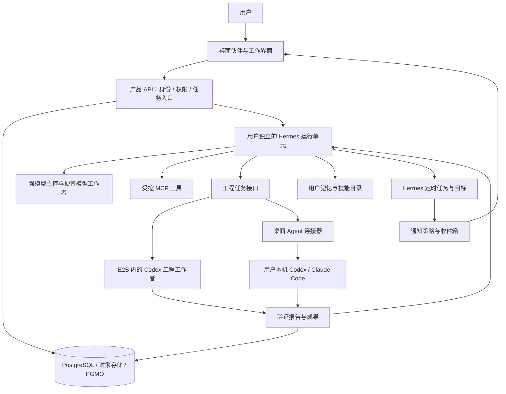
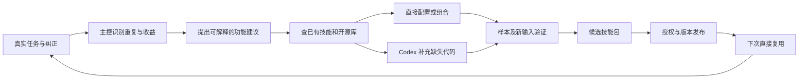

# 桌面 AI 伙伴：完整架构方案

设计日期：2026-09-23。本文中的“采用”指架构选择，不代表集成已经验证。

## 1. 产品和首版范围

产品为用户提供一个持续相处、能一起工作的 AI。它在协作中记住人的偏好和工作方式，识别重复劳动，提出改进，经同意后复用现有工具或开发缺失功能，之后重复使用。工作步骤由强模型根据任务决定，基础设施只负责状态、权限、资源、成果和可验证的完成条件。

第一条验收链路选“文件与表格整理 → 回复草稿 → 用户纠正 → 保存为工具 → 新输入再次成功”。它不依赖特定国家的外卖平台，也容易展示实际价值。样例可用客户需求与报价材料，但通用架构不绑定外贸行业。

首版包含：文本协作、桌面常驻、成果卡片、可编辑记忆、一项真实工具生成能力、主动完成通知、用户开启后的轻量问候、外部 Codex/Claude Code 联动。语音输入和短 TTS 在主链路稳定后加入。

初始工程假设：先在一个桌面系统完成完整体验；当前开发环境便于先验证 Windows，macOS 在公开推广前按首批用户设备决定优先级。这不是目标市场所在地的假设。云端使用 Linux；文案可本地化，时间保存 UTC 并保留用户 IANA 时区。

## 2. 技术选择

| 层 | 主选 | 使用方式 |
| --- | --- | --- |
| 桌面 | Electron + Vue 3 + TypeScript | 成熟桌面壳；UI 自己设计；小范围复用 AIRI 的合适组件 |
| UI 基础 | shadcn-vue、VueUse、JSON Forms | 基础控件、桌面交互辅助、技能表单；不重写基础控件或表单引擎 |
| 产品服务 | FastAPI + Pydantic | 一个模块化服务；API 与后台消费者可同仓库不同进程 |
| 身份与数据 | Supabase Auth + PostgreSQL + Storage | 先用托管部署减少运维；使用其开源组件不意味着云服务免费 |
| 持久消息队列 | PGMQ / Supabase Queues | 接收异步请求、投递通知与重试适配动作；不代替 Agent 的计划 |
| 主运行底座 | Hermes Agent | 会话、记忆、技能、模型接入、委派、目标、用户定时任务 |
| 工程执行 | Codex App Server / SDK | 用户已有本机 Agent，或隔离云端工程工作者；共用任务接口 |
| 其他 Agent | 未修改的 Claude Code；后续 ACP 适配器 | 用户本人完成官方登录；订阅与 API 路径分开 |
| 云端代码沙箱 | E2B | 先用托管服务，SDK 接入；自托管运行时作为后续选项 |
| 工具协议 | MCP 官方 SDK | 复用工具服务器；包装本产品特有的任务、记忆视图和成果操作 |
| 浏览器 | 先用 Hermes 已有驱动；必要时 Playwright MCP | 一个任务只选一个驱动，不同时维护多套浏览器状态 |
| 观测 | 结构化日志 + Langfuse 社区功能 | 记录费用、耗时、结果和版本；不把原始私密内容默认送入日志 |

来源与许可范围见[开源复用清单](04-open-source.md)。选择 Vue 是为降低 AIRI 组件复用的跨框架成本；AIRI 包含很多工作区依赖，不能当作一个随装随用的独立 UI 库。[AIRI 桌面依赖](https://github.com/moeru-ai/airi/blob/308ee2b3aa8587262aa7a458d5d68407cb5f2342/apps/stage-tamagotchi/package.json)

## 3. 逻辑结构



这是模块图，不是要求把每个框拆成微服务。最初部署只有桌面客户端、产品 API/消费者、数据库服务、用户运行单元以及按需创建的执行沙箱。语音和观测可使用托管服务或独立组件；无需先建设 Kubernetes 集群。

## 4. 三条执行路径

**A. 云端独立工作。** 桌面向产品 API 提交任务，API 验证身份、登记请求并放入持久队列，消费者调用 Hermes Runs API。主控使用工具或隔离工作者完成任务；成果进入对象存储。桌面断开不会取消云端任务。云端主控使用平台允许提供的模型 API或用户自带 API，不把个人聊天订阅令牌转成公用推理接口。

**B. 用户已有 Agent 工作。** 主控产生任务简报，已配对桌面收到任务，在用户选择的工作区启动其本机官方 Agent。结果经连接器回传，主控继续验收。身份凭证保留在官方 Agent 的本机存储中；产品保存连接状态和运行 ID。用户关闭电脑时，这条路径不可用。只有用户事先允许并明确费用来源，才能改走云端。

**C. 主动任务。** Hermes 定时任务或业务完成事件产生候选消息。产品先检查用户启用状态、时区、安静时段、频率、重复和过期，再决定是否调用模型措辞及投递。无变化时不唤醒强模型。通知正文与状态进入产品收件箱，设备在线后再显示。

三种路径共用 `TaskBrief`、`ArtifactRef`、`RunEvent` 与权限规则。框架接口适配在后端或桌面主进程完成，UI 不直接依赖某一家 Agent 的原始事件。

用户已有订阅的认证方式、费用归属、官方接入条件和离线处理见[外部 Agent 联动](06-agent-connections.md)。云端主控的模型调用仍需单独计费，不能从工作者使用订阅推导整条任务免费。

## 5. 模型分工与主控职责

初始只设置两个模型档和一种无需模型的执行方式：

- 强模型：理解工作、拆分、选择工具、根据用户纠正调整、审核关键结果、决定是否开发新能力。
- 便宜模型：约束明确的提取、分类、批量格式转换、资料整理。主控可以选择直接做简单工作。
- 程序执行：已验证脚本、数据校验、调度筛选、成本计算。能确定性执行的重复步骤不每次重新推理。

人格是统一的产品设定，不随工作者切换。用户无需认识“CEO、工人、MCP”等内部名词；任务详情可显示实际执行器和费用来源。

主控工具集暴露：任务创建/查询、工程工作者调用、成果查看、候选技能管理、记忆管理、通知建议和已接入的业务工具。权限判断在工具入口实施，不能依赖模型自行遵守一句提示词。

默认使用 Hermes 原生委派处理当前回合内的短子任务；跨进程、持久任务优先验证其现有 Kanban。Kanban 的本地数据库及运行进程约束需要在 M00/M03 验证，不能拿其逻辑 tenant 字段代替 SaaS 租户隔离。[目标](https://hermes-agent.nousresearch.com/docs/user-guide/features/goals)、[Kanban](https://hermes-agent.nousresearch.com/docs/user-guide/features/kanban)

若跨机器工作者不能直接使用该派发机制，使用产品消息队列做“任务交接与结果回收”。不再写第二套规划器、子 Agent 对话循环或通用 DAG 引擎。

## 6. 数据唯一归属

| 数据 | 权威来源 | 其他地方如何使用 |
| --- | --- | --- |
| 用户、设备、订阅、同意设置、配额 | 产品 PostgreSQL | API 校验；桌面缓存显示 |
| 伙伴主会话、检索历史、精简用户记忆 | 每个用户独立的 Hermes 数据目录 | 前端经适配器查看；不另建一份竞争记忆 |
| 外部 Agent 内部上下文 | 各官方 Agent 自己的运行记录 | 只把任务摘要、产物和证据回传伙伴 |
| 定时任务定义 | Hermes Jobs/cron | 产品存 ID、映射及显示缓存；不另设业务 cron |
| 执行真实状态 | 当前执行器及其回执 | 产品任务表是持久投影，过期时标明待核对 |
| 成果内容 | 对象存储 / 用户授权本地工作区 | DB 仅存路径映射、哈希、归属及展示元数据 |
| 已发布技能版本 | 不可变技能包 + 产品版本登记 | 运行单元只挂载当前生效版本 |
| 主动消息及投递状态 | 产品收件箱表 | 桌面通知是展示，不是唯一消息存储 |

Hermes 基础记忆体量有限且按会话读取快照，适合精简偏好；详细操作步骤放技能，历史细节使用会话检索。第一版不同时接入 Mem0、Letta、Honcho 和向量库。以后只有真实召回测试发现不足，才在同一个 `MemoryStore` 接口后迁移。[记忆文档](https://hermes-agent.nousresearch.com/docs/user-guide/features/memory)

## 7. 记忆、人格和工作习惯

记忆来源限定为对话、用户上传/选取的材料、用户允许的工具结果和经过同意的桌面上下文。每条展示给用户的记忆携带来源引用、更新时间、作用域和状态；模型猜测与用户明确确认分开标记。

主模型写入人格与长期记忆；工作者提交观察建议。跨任务共用记忆写入串行化，避免多个工作者互相覆盖。产品不直接跨进程改写 Hermes SQLite 或记忆文件，使用现有命令/工具；缺少管理接口时才添加范围明确的插件。

“忘记”要处理记忆条目、当前会话快照、派生缓存和重新学习的来源：用户可选择只删除一条偏好，或连同相关历史删除。仅删记忆但保留原聊天，可能再次被模型学到，界面应说明选择。删除标记应用于检索和后续学习，备份按保留期过期。

轻量问候基于用户主动告知和已授权的事实。例如知道用户今天有演示，可以询问进展；没有观测依据就不能声称看见用户工作了几小时。陪伴频率可调，关闭陪伴不降低工作功能。

## 8. 学会并开发一个新能力



主控可以选择不开发：一次性任务或收益太低时，现有工具已经够用。不能为了展示“成长”而制造新代码。

技能保留 Agent Skills 的 `SKILL.md` 和附属脚本/资源格式；产品只增加可选 `capability.json`、输入/输出 Schema、版本和验收报告。用户界面使用 JSON Forms 与已有组件渲染表单、文件入口、表格和结果卡，不让模型任意执行前端 JavaScript。[Agent Skills](https://agentskills.io/specification)、[JSON Forms Vue](https://jsonforms.io/docs/integrations/vue/)

状态依次为 `draft → testing → ready → active → deprecated`，失败保留证据。升级创建新版本，切换活动指针；运行中的任务固定原版本。发布器与模型工作区分离，生成代码不能修改发布规则、计费或应用自动更新。

候选方案先查本产品已登记技能和审核过的依赖，再查官方仓库；未知依赖记录来源、版本、许可证和新增权限。程序不把网络上的安装命令直接提升到宿主执行。构建包安装在隔离构建环境，锁定依赖；日常运行不临时拉取 `latest`。

## 9. 工具、沙箱与桌面边界

云端 Hermes 运行单元彼此隔离，只有该用户的数据目录。模型可调用的任意代码、浏览器和文件操作都进入执行沙箱或范围受控的工具服务，不能直接接触产品服务主机。

E2B 接入是明确的适配工作，不是声称 Hermes 已自带相应后端。优先使用 SDK 提供的执行和文件能力，不重写沙箱。工程工作者在沙箱内部经 stdio 启动 Codex；平台数据库主密钥、其他用户凭证和发布权限不进入沙箱。必要模型调用使用任务范围受控的凭证/网关，不能把沙箱视为可以安全放置无限额主密钥的保险箱。[E2B SDK](https://github.com/e2b-dev/E2B)、[运行时](https://github.com/e2b-dev/runtime)

用户本机的官方 Agent 可以沿用其官方执行与审批机制，但产品只提供独立或明确选定的工作目录。Agent 输出 HTML/SVG 等主动内容使用隔离预览；Electron 渲染进程无 Node 权限，IPC 按方法和参数校验。[Electron 安全指南](https://www.electronjs.org/docs/latest/tutorial/security)

连接外部业务系统，优先使用官方 API/SDK 或成熟 MCP；其次浏览器操作。首个正式连接器只选一个用户常用服务。已有第三方 MCP 仍需验证令牌作用域、租户隔离和写操作行为，MCP 协议本身不提供这些保证。

## 10. 长任务、失败与重试

任务生命周期：`queued → running → waiting_user / waiting_device / waiting_quota → running → succeeded / failed / interrupted / cancelled`。取消先进入 `cancelling`，收到执行器终止回执后才标为取消完成。首次排队、恢复、每次尝试都有不同标识。

用户关窗口、流式连接断开、模型请求失败、进程崩溃是不同事件。连接断开只重连状态；模型失败按可重试性限次；进程崩溃核查已保存成果与副作用回执，再决定续做哪一步。不承诺恢复模型被打断瞬间的全部内部状态。

Hermes 的 Runs 记录和 SSE 有保留范围；不能把短期事件流当成永久审计。产品消费者保存重要状态和成果事件，客户端重连读取任务快照。请求重试使用幂等键，但“只创建一个 run”不等于“邮件只发送一次”。[Runs API](https://hermes-agent.nousresearch.com/docs/user-guide/features/api-server)

所有外部写动作记录 `action_id、参数哈希、目标、权限、执行回执`。支持幂等键的提供商复用该键；结果不明时查询远端，无法确认则等待核对。队列可能再次投递，消费者必须幂等。到期/取消的本地任务不能在设备几天后上线时突然执行。

后台代理审查完成条件时先检查文件存在、Schema、确定性测试和外部回执，再由强模型判断语义。重要的运行证据归属于固定版本和输入，不能用旧测试结果验收新技能。

## 11. 主动交流与语音

任务通知默认只展示必要状态；问候与改进建议由用户单独开启。对同一事件去重，过期内容失效；一次拒绝某类建议后降低对应频率。每天允许的非必要主动消息数量、安静时段和声音分别可设置。

定时触发复用 Hermes；消息筛选复用普通代码规则；真的需要理解内容时才用模型。任务完成可直接填通知模板，避免每次都调用强模型。用户不在线时先写收件箱，设备回来后合并展示。

语音首版采用按住说话、文字确认与可选短回复。STT 可接 faster-whisper，TTS 可接 Kokoro 或已支持的商业服务；目标语言、延迟和音色需实测，不承诺一种开源模型覆盖所有市场。持续语音后续选 Pipecat 或 LiveKit Agents 中的一套。[faster-whisper](https://github.com/SYSTRAN/faster-whisper)、[Kokoro](https://github.com/hexgrad/kokoro)

## 12. 部署、费用与增长

内部验证：开发环境启动产品服务与一个用户 Hermes 运行单元，云沙箱按需创建。身份、队列与成果通过同一套接口。这里的“本地开发”不代表把个人订阅凭证上传云端。

小规模内测：每个用户一个独立运行单元及卷，网关仅在私网可达；容器仅用于运行可信底座，生成代码仍进入沙箱。先固定小规模配额再测每用户空闲内存、启动时间和日均费用。Hermes 定时任务依赖存活的调度进程，不能随意休眠运行单元又承诺准时触发。

规模化：只有空闲成本或并发数据证明需要，才把用户定时触发迁移到一个成熟集中调度服务。迁移时每个任务只能有一个活跃调度拥有者，避免新旧同时执行；不用在第一版预建这套平台。

费用分成平台服务、平台 API、用户自带 API、用户官方订阅、沙箱与语音。订阅执行未返回可计量金额时记录“供应商订阅额度，金额未知”，不能显示为零成本。费用汇总包含规划、子任务、评审、重试、语音和沙箱。

设置任务预算、最大回合数、并行数、沙箱时限和日配额。费用达到阈值停止启动新工作；已在进行的调用可能产生尾部费用，界面和结算须体现。任何更换付费来源都受用户预设规则约束。

## 13. 开发验收与时间判断

先完成 M00 的证据，再冻结依赖版本。功能模块划分和每个子步骤见[开发清单](03-module-backlog.md)。测试贯穿开发，不能把身份隔离、取消、删除与成果真实性留到上线前才做。

核心发布条件：重复请求不重复启动；跨用户访问失败；主链路新输入通过；技能错误可回退；关窗口后云任务仍可查询；本机离线显示等待；取消与额度用尽如实呈现；记忆可改可删；主动消息能关闭；依赖许可与资产来源有记录。

在关键接入验证通过、范围不扩大且两名熟练工程人员能持续投入的假设下，可按约 2–3 周完成技术验证与可操作演示、约 8–12 周争取小规模内测规划。它是排期假设，须在 M00 后重估；完整跨平台、多渠道、持续语音和开放技能市场不包含在内。

## 14. 项目目录建议

```text
apps/desktop/                 桌面主进程、登录桥、Vue 界面
services/control/             产品 API、队列消费者、账户与配额
packages/contracts/           共享 Schema、生成类型、事件规范
packages/ui/                  设计变量与业务组件
adapters/hermes/               运行 API 与事件转换
adapters/agents/               Codex、Claude Code、未来 ACP
integrations/tools/           业务工具、MCP、E2B 适配
skills/templates/             已审核的技能模板与依赖白名单
tests/acceptance/              核心用户链路和故障演练
infra/                        部署、备份、升级、运行配置模板
docs/                         架构决策、来源及接口说明
```

以上为未来代码职责划分，本次只交付设计文件。外部上游代码优先作为固定版本依赖或独立组件引用；需要取用 AIRI 文件时保留来源与许可，并记录本地改动以便后续升级。
