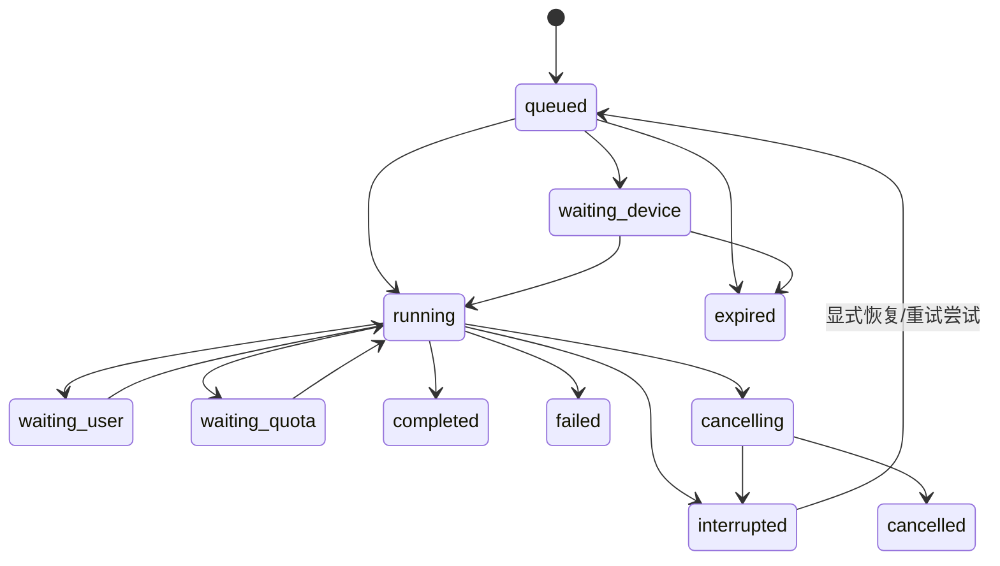

# 模块接口与数据契约

版本：设计草案 v0.1。以下命名和 JSON 是**本产品拟定的接口**，不是声称 Hermes、Codex 或 Claude 原生接受这些字段。底座适配器负责转换；原生类型从所选版本的官方定义生成或引用。

## 1. 契约归属

`packages/contracts/` 保存版本化 JSON Schema；服务端用 Pydantic 验证，桌面生成 TypeScript 类型。跨模块消息都包含 `schema_version`。身份来自已验证会话，不能相信请求正文自报的 `user_id`。兼容增加可选字段；破坏性修改升主版本。

| 接口 | 提供方 → 使用方 | 责任 |
| --- | --- | --- |
| ProductTaskAPI | 产品服务 → 桌面 | 任务提交、状态快照、事件、取消、用户输入 |
| SupervisorRuntime | Hermes 适配器 → 产品服务 | 主会话、运行生命周期、目标、记忆/技能调用 |
| AgentExecutor | Codex / Claude / 后续 ACP 适配器 → 主控工具 | 能力探测、任务启动、事件、授权响应、停止、成果 |
| ToolGateway | 工具服务 → 主控和工作者 | 输入验证、权限、执行边界、副作用回执 |
| ArtifactStore | 对象存储适配器 → 各模块 | 归属、哈希、有效期、下载与安全预览 |
| CapabilityRegistry | 技能发布器 → 主控与 UI | 不可变版本、输入表单、校验记录、活动指针 |
| NotificationPolicy | 产品服务 → Hermes 调度与桌面 | 候选消息筛选、收件箱、去重与投递 |

这些是逻辑模块，不要求拆成独立网络服务。

## 2. TaskBrief

```json
{
  "schema_version": "1",
  "task_id": "task_demo_001",
  "parent_task_id": null,
  "idempotency_key": "client_generated_request_id",
  "objective": "从需求材料中提取项目，生成汇总表和待确认问题",
  "inputs": [{"artifact_id": "artifact_input_1", "sha256": "<hash>"}],
  "acceptance": [
    {"kind": "schema", "ref": "schemas/request-table.v1.json"},
    {"kind": "semantic", "description": "缺失字段标记待确认，不能编造"}
  ],
  "permission_grant_id": "grant_001",
  "execution_policy": {
    "allowed_connections": ["connection_001"],
    "cloud_fallback_allowed": false,
    "workspace_id": "workspace_001",
    "max_delegation_depth": 1,
    "max_parallel_workers": 2
  },
  "budget": {"currency": "USD", "max_api_spend": 2, "max_wall_seconds": 900},
  "expires_at": "2026-10-01T12:00:00Z"
}
```

数字仅演示字段，并非价格预测或推荐统一预算。输入引用、权限及预算在服务端再次校验。模型可以提出子任务，但不能自行扩大用户授权。预算由父任务分配，共享累计账本，避免每个子任务各自花掉整笔预算。

`permission_grant_id` 引用的授权包含用户、任务/工作区、允许工具、文件范围、外部账户、读写操作、到期时间和授权来源。已允许的日常操作可以自动进行；超出范围才产生明确的授权请求。

## 3. 运行状态与事件

任务生命周期：



图中省略了各等待态可取消、可到期的边；代码状态表必须覆盖。`completed` 要同时满足执行结束和验收通过；底座“回合完成”只能先映射为执行完成。失败的尝试保留不可变记录；恢复创建新的 `attempt_id`，仍属于原任务。

```json
{
  "schema_version": "1",
  "event_id": "evt_001",
  "task_id": "task_demo_001",
  "attempt_id": "attempt_001",
  "seq": 12,
  "type": "artifact.ready",
  "occurred_at": "2026-10-01T11:50:00Z",
  "source": {"executor": "codex", "native_run_id": "opaque_id"},
  "payload": {"artifact_id": "artifact_result_1"}
}
```

重要事件包括 `task.started`、`task.state_changed`、`approval.required`、`artifact.ready`、`usage.recorded`、`validation.finished`。自然语言进度单独标为 `progress.message`，它不构成完成证据。系统不要求获取或存储供应商不公开的内部推理。

产品为同一任务持久化单调 `seq`，根据上游事件 ID 或适配器去重键幂等写入。客户端先读快照，再按事件游标续读；游标已过期就刷新快照。源事件乱序、重复和连接断开都不应让已完成任务退回运行中。多执行器事件不存在天然全局时序。

拟定产品 API：`POST /api/v1/tasks`、`GET /api/v1/tasks/{id}`、`GET /api/v1/tasks/{id}/events`、`POST .../cancel`、`POST .../inputs`。提交响应表示已接收，不表示已执行。相同幂等键但不同请求内容返回冲突。

## 4. AgentConnection 与 AgentExecutor

```json
{
  "connection_id": "connection_001",
  "executor": "codex",
  "executor_version": "<verified-version>",
  "location": "user_device",
  "device_id": "device_001",
  "transport": "stdio",
  "auth_mode": "official_subscription",
  "credential_owner": "official_client",
  "billing_source": "user_provider_subscription",
  "availability": "online",
  "capabilities": ["files", "code", "cancel", "resume", "approval_events"],
  "allowed_workspace_ids": ["workspace_001"],
  "policy_verified_at": "2026-09-23"
}
```

`capabilities` 来自版本探测和验证结果，不能为了统一界面假装支持。云端 API 的认证模式、费用归属不同；连接记录只存密钥引用，绝不内嵌明文密钥或官方订阅 token。

`AgentExecutor` 方法：

| 方法 | 输入 | 输出 / 语义 |
| --- | --- | --- |
| `probe()` | 连接与已授权工作区 | 版本、能力、认证和在线状态；不读取完整凭据 |
| `start()` | TaskBrief、输入位置映射 | 原生运行引用；重复请求不会重复开任务 |
| `get()/stream()` | 运行引用 / 游标 | 快照 / 标准 RunEvent；不支持重放时由产品持久层补齐 |
| `respond_to_approval()` | 审批 ID、决定、已验证用户会话 | 与原动作关联的回执；过期或参数变更失效 |
| `cancel()` | 运行引用 | 已收到/已停止/停止未知；不能立即统一回成功 |
| `resume()` | 原生会话引用、检查点 | 新 attempt 引用；仅在能力支持时开放 |
| `collect_artifacts()` | 运行引用、约定成果清单 | ArtifactRef 列表与验证证据 |

外部 Agent 的工具授权请求绑定 `user_id + task_id + action_id + immutable_args_hash + expires_at`。客户端展示的目标必须与实际执行参数一致。文本中出现“用户已批准”不会构成系统授权。

工程任务是 TaskBrief 的一种类型，补充：仓库/文件快照、依赖来源候选、输出目录、测试命令、允许安装范围及禁止改动范围。工程结果包含完成状态、改动摘要、成果、测试的退出码/输出引用、费用和未解决项。工作者的自评不是唯一验收依据。

## 5. 工具、副作用与成果

工具调用都带权限引用、输入 Schema、超时、输出上限。只把需要的文件和临时凭据提供给执行环境。产品管理数据库、平台密钥、发布密钥不进入模型代码工作区。

`ActionLedger` 保存动作的 `action_id、task_id、target、args_hash、idempotency_key、state、receipt_ref`。状态为 `prepared / sent / confirmed / failed / unknown`。发生超时且结果未知时，优先查询外部系统。没有可靠幂等机制又无法核对的写动作进入待处理，而不是自动再做一遍。

`ArtifactRef` 包含 `artifact_id、owner_id、task_id、kind、mime_type、size、sha256、storage_ref、created_at、retention_until`。文件实际内容应与哈希对应。接口按当前权限生成短期访问地址；固定公开 URL 不作为私人文件默认存储方式。

HTML/SVG/生成代码是待预览的数据，不是可信 UI。预览在无 Node 权限、受 CSP 和网络限制的隔离环境中进行；下载/执行与查看分别授权。Office/PDF 解析和压缩包解包设置文件大小、页数、路径与资源限制。

## 6. 记忆与技能

记忆管理层提供 `list / propose / accept / edit / forget`。核心字段：`memory_id、text、scope、source_refs、confidence_kind、updated_at、status`。`confidence_kind` 区分用户明确说明、已确认总结和待确认推断。最终记忆仍归 Hermes；产品保存来源与管理索引，不维护第二个竞争的事实库。

若上游没有满足删除/来源管理的公开入口，添加 Hermes 插件或有边界的扩展；不要直接从多个进程写其内部数据库。删除涉及原历史时要明确用户选项，当前会话快照与检索缓存随之更新。备份保留期与删除状态分开记录。

技能包沿用现有 Agent Skills 格式，增加本产品元数据：

```text
skill-name/
  SKILL.md
  capability.json
  schemas/input.json
  schemas/output.json
  scripts/...
  tests/fixtures/...
  validation/report.json
  dependency-locks/...
```

`capability.json`：名称、版本、输入/输出 Schema 引用、执行入口、所需权限、依赖来源、支持运行环境、作者/来源、包哈希。报告关联该包哈希、测试输入哈希和实际执行环境。模型不能通过自己写一份“通过”报告绕过独立验证器。

发布步骤：草稿 → 隔离构建与验证 → `ready` → 权限检查 → 原子切换活动版本。回退只切活动指针；运行中的任务固定旧版本。任何功能升级新增权限时，旧版本授权不自动扩大。技能只能修改自身命名空间，不能修改产品权限、计费与发布程序。

## 7. 主动消息与费用

`NotificationCandidate`：用户、来源事件、种类、关联任务、事实依据、建议内容、去重键、最早发送时间、到期时间。策略先筛选用户偏好、时区、安静时段和频率，再决定是否调用模型组织语言。

用户收件箱持久保存消息，投递尝试单独记录 `queued / delivered / read / dismissed / expired`；操作系统通知是否出现不等于用户已读。无变化的周期检查不重复通知。关闭主动问候仍可保留用户选择的任务完成通知。

费用事件按任务/attempt 汇总：供应商、模型/执行器、付款方、计费类型、token/时长、金额、币种、计量来源、是否估计。缺失数据用 `null` 和原因，不能当作 0。用户订阅的剩余额度按供应商可读范围展示，不能依据 token 自行杜撰余额。

预算检查在发起新调用前执行；并行任务采用预算预留与完成后对账。取消后的尾部费用、沙箱空闲和评审重试都计入。切换付费来源必须符合当前任务的授权策略。

## 8. 持久表与权威边界

| 数据表/存储 | 内容 | 注意 |
| --- | --- | --- |
| profiles / devices / agent_connections | 用户偏好、设备、执行器描述 | 不保存官方订阅凭据 |
| tasks / task_attempts / run_events | 任务和执行状态投影 | 上游状态变旧时标记需对账，不凭心跳伪判成功 |
| permission_grants / approvals / action_ledger | 权限、审批、副作用证据 | 绑定用户及参数，撤销立即阻止新动作 |
| artifacts / objects | 文件元数据与内容 | RLS、服务端检查、保留期与导出 |
| skill_versions / active_skills | 技能版本和活动指针 | 不可变包、原子切换、任务固定版本 |
| memory_index | 管理索引、来源和删除状态 | 主记忆内容和检索归 Hermes |
| scheduled_job_refs | 上游定时任务 ID 与用户映射 | 定义归 Hermes；缓存不独立触发 |
| inbox / delivery_attempts | 通知内容与投递 | 去重、到期、偏好 |
| usage_events / budget_reservations | 全链路用量与预留 | 金额未知与真实零费用区分 |

所有跨用户表有所有者和 RLS；服务端高权限凭据仍需应用级归属校验，不能以启用 RLS 为由忽略服务端越权测试。Hermes 每用户独立目录/进程及存储卷；产品数据库的租户字段不能补救共享可写主目录的隔离缺陷。

## 9. 最小兼容性测试

每个运行时适配器都使用同一套场景：正常完成；重复启动；授权拒绝；客户端断线；执行器退出；额度不足；取消未立即完成；已产生副作用后超时；跨用户文件引用；输出缺失或哈希错误。能做到的能力标支持，其余返回明确的 `unsupported`，不能静默降级。

契约与状态测试从 M00/M11.1 开始，随后由真实官方执行器补上集成测试。没有真实执行证据前，只能称接口草案和模拟测试通过。
