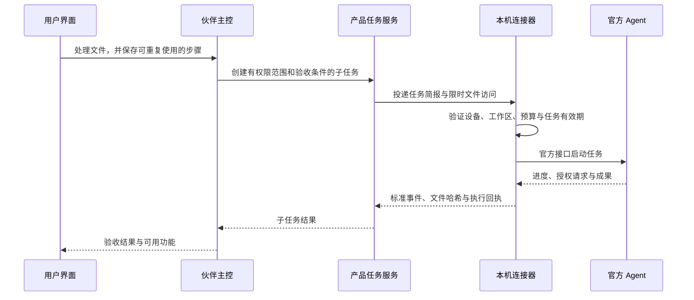

# 外部 Agent 联动：让用户已有的订阅参与工作

核查日期：2026-09-23。此处将口述的“cloud 套餐”按 Claude 订阅理解。接入设计尚未实际运行。

## 产品决策

把“连接我的 Agent”设为一级功能。用户选择已有的 Codex 或 Claude Code，完成官方登录，指定可用工作区。伙伴可以委派任务、展示进度、请求必要授权、收回文件并验收。用户始终面对一个伙伴，无须在几个聊天窗口之间搬运提示词。

**第一版连接官方本机 Agent；需要关机后仍持续执行时，另走明确计费的云端 API 路径。** 这会降低重复购买推理能力的阻力，但不能宣传为“购买我们的产品就能无限使用所有模型”。

## 已核实的接入边界

| 对象 | 可采用的入口 | 额度与产品边界 |
| --- | --- | --- |
| Codex | 官方 App Server 的本机 stdio 接口；由其管理 ChatGPT 登录 | 官方提供 ChatGPT 登录及账户/额度接口；具体权益以账户实际返回为准。API 计费另算 |
| Claude Code | 用户自己的、未经修改的官方程序；官方登录；使用其程序化调用接口 | 当前支持页说明 Agent SDK、`claude -p` 等仍使用订阅限额，但不能把这一点扩张为任意令牌代理服务 |
| 其他 Agent | 先检查官方 SDK/协议；第三种确有需求时评估 ACP | 支持认证、取消、恢复和成果交接才算完整连接；只有文本输入输出只能标为有限支持 |
| ChatGPT/Claude 网页聊天窗口 | 不作为首版运行接口 | 本方案没有核实可接管任意历史网页对话的通用官方接口；不依赖模拟点击网页来交付后台任务 |

Codex 的相关事实来自 [App Server](https://learn.chatgpt.com/docs/app-server) 和[认证文档](https://learn.chatgpt.com/docs/auth)。这里利用官方 Agent 的运行接口，不把 ChatGPT 订阅等同于通用 API 余额。

Claude 的官方条件包括：产品集成适用商业条款；程序保持原样、保留内置认证方式；终端用户自行认证并直接承担其使用费用；产品不能收集或转接 Claude 会话令牌，也不能暗示官方背书。官方同时明确允许用户在未经修改的 Claude Code 中登录自己的订阅。[官方集成与认证条件](https://code.claude.com/docs/en/legal-and-compliance)

Claude 支持页顶部的 2026-06-15 更新暂停了此前拟议的额度变更；下方旧版“每月抵扣额”内容被明确标为不再按原日期生效。因此本方案不使用旧额度数字设计商业模型。[当前订阅说明](https://support.claude.com/en/articles/15036540-use-the-claude-agent-sdk-with-your-claude-plan)

## 用户体验

设置页有“连接 Codex”“连接 Claude Code”入口，显示是否安装、是否登录、设备在线状态、授权工作区、能力和费用来源。登录入口转到官方流程；不向用户索取 Cookie、会话 token 或复制认证文件。

开始任务时只显示可理解的选择，例如：

- “使用这台电脑上的 Codex”：占用用户对应订阅或已配置 API 额度，设备须在线。
- “交给云端执行”：显示估计费用与预算，设备可离线。
- “按我的规则选择”：仅在预先允许的执行器和费用来源中选。

默认无需反复选择。用户保存偏好后，主控依据任务能力、在线状态、预计等待和预算进行路由；使用不同付费来源需要已有的明确授权。额度不足时可以等待恢复、换另一个已连接 Agent，或选择云端。平台不通过增加账号或重复请求绕过额度。

主控规划和验收本身也有费用。当前主选架构的 Hermes 云端主控使用模型 API，接入用户订阅主要节省被委派工作的推理开销，**不会自动消除主控和云基础设施成本**。如果试用者明确要求完全依赖自己的订阅，可单独验证“本机官方 Agent 担任主控”的产品模式；它替换该会话的主循环，不在现有主控之上再套一层主控，也不承诺关机后的自主执行。

## 连接器的职责

本机连接器是 Electron 主进程中的受控模块。它只启动白名单执行程序，参数作为数组传递，不把模型生成文本拼接成宿主 shell 命令。任务工作区和官方认证存储分开管理；连接器不直接读取或同步认证存储。启动程序所需的认证由官方程序按自身机制处理。

云端只保存 `connection_id、device_id、executor、version、capabilities、billing_source、last_seen` 等描述。连接器到云端使用设备配对凭据；这是我们产品的凭据，与供应商模型凭据分离。

本地文件默认留在授权工作区。需要上传的输入和成果在任务简报中列出；回传使用限时对象访问、大小限制和哈希校验。远程工作者不直接获得用户整个文件目录、云盘或全量聊天历史。

## 一个接口，多种执行器

采用本产品的 `AgentExecutor` 适配接口：`probe → start → stream/get → respond_to_approval → cancel → collect_artifacts`。可选 `resume`，不支持时如实声明。字段见[接口契约](05-contracts.md)。

第一版原生适配 Codex App Server 和 Claude Code。后者复用官方程序化接口；优先选择能传递所需权限与状态的官方 SDK/CLI 方式，具体版本通过 M00 实测后锁定。[Claude 程序化调用](https://code.claude.com/docs/en/headless)、[Agent SDK](https://code.claude.com/docs/en/agent-sdk/overview)

ACP 是面向客户端与编码 Agent 的连接协议，可以减少后续重复适配；应复用其 SDK 和现有适配器，不能凭协议存在便假设各执行器功能齐全。[ACP](https://github.com/agentclientprotocol/agent-client-protocol)、[Codex ACP 适配器](https://github.com/agentclientprotocol/codex-acp)

MCP 用于工具和资源连接。以后可以把我们的 `run_saved_skill`、`get_artifact` 暴露给其他 Agent，让联动双向发生。MCP 工具协议本身不替代所有任务生命周期、设备管理与费用归属。

## 异常与恢复

| 情况 | 产品行为 |
| --- | --- |
| 电脑离线、睡眠 | 状态变为 `waiting_device`；到期失效；不默默改为平台付费执行 |
| 订阅限额不足 | `waiting_quota`；展示执行器提供的恢复信息，缺失则标未知 |
| 用户退出官方账号 | `waiting_user`；由用户重新完成官方登录 |
| 产品客户端与云端断线 | 已启动执行状态待核对；设备恢复后按原 run ID 对账，不立即重跑 |
| 官方 Agent 进程退出 | 记录退出与已有产物；能恢复则恢复，不能恢复则新建显式重试并关联原任务 |
| 取消请求 | 先 `cancelling`，获得终止证据后才 `cancelled`；外部已发生动作单独记录 |
| 执行器版本不兼容 | 暂停该连接并展示升级/回退方案；不把原始错误伪装成任务完成 |

不同 Agent 同时修改一个目录会互相影响。第一版同一工作区只允许一个写任务；独立任务使用独立目录或 Git worktree。多个执行器可以承担不同任务，但不会同时“接管”同一个主会话。

## 交付顺序与价值

1. 跑通 Codex：官方登录 → 小任务 → 文件 → 取消 → 额度异常。
2. 在同一接口后接 Claude Code，证明前端无须重写。
3. 加入本机离线、任务到期、断线对账和明确的计费切换。
4. 有第三个 Agent 的真实需求后再引入 ACP；有外部调用需求后再发布产品 MCP。

对用户的价值是保留已有工具和订阅，获得统一记忆、任务体验和可重复功能。对公司的价值应来自这些产品能力与托管服务，不能只靠转售模型额度。是否提升转化率仍需内测验证，不能从“能接入”直接推导商业成功。
