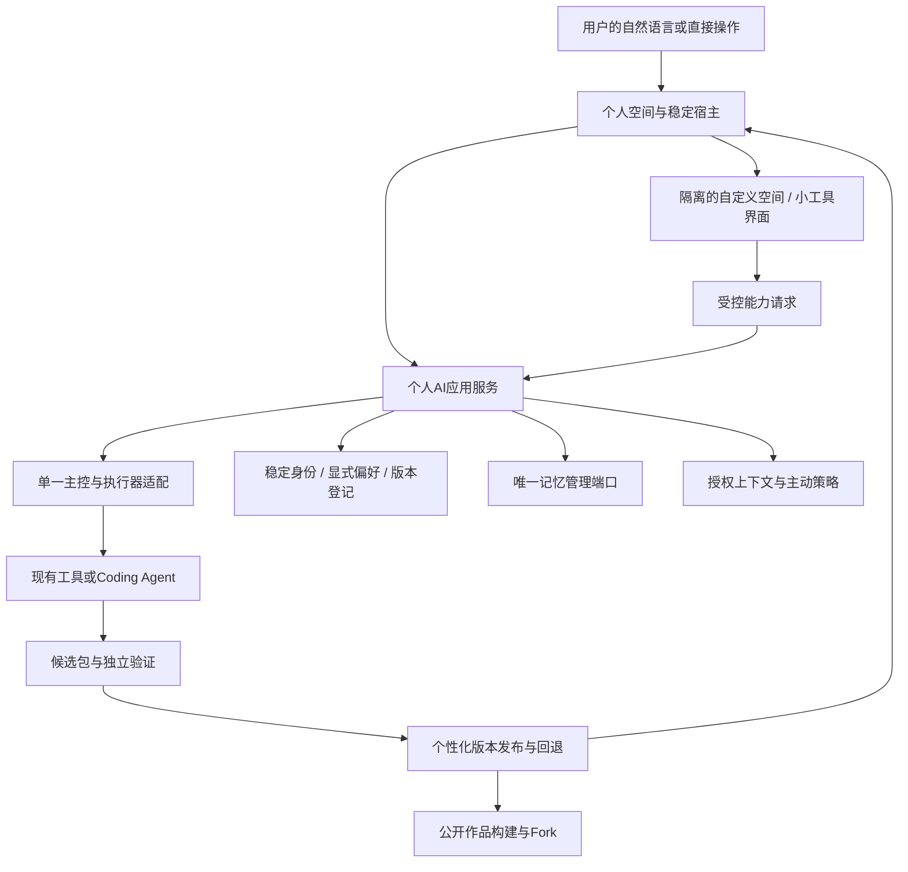

# ADR-002 · Personal AI 的可成长界面与个性化版本

状态：架构方向已裁定；接口为设计草案，尚未实现或冻结为公共契约。依据用户最新 [产品定位](../product/PERSONAL-AI-VISION.md)。本次不安装依赖、不调用模型、不修改已验收产物或156张原卡的哈希。

修订r2：依用户进一步明确，以AI直接编写/修改实现为定制主路径。撤销“先做预设样式与布局配置，再把代码生成作为高级兜底”的开发顺序；代码包宿主、开发接口与增量修改链路前置。社区作品是可选起点，产品不建设多套官方模板供选择。

## 1. 现状判断

现有技术路线可继续使用，无需整体重做。但“可生成工具”不自动意味着“可改变自己的界面”；“统一人格”也不等于可携带、可版本化的个人 AI。

| 目标 | 当前证据 | 裁定 |
| --- | --- | --- |
| 同一个伙伴主控、替换模型/执行器 | ARCHITECTURE、M03、C04 有设计；真实链路未打通 | 保留单主控，不增加第二套通用Agent循环 |
| 人格、长期记忆 | M06/C07 有设计，Hermes为当前记忆来源 | 增加稳定个人AI身份和显式偏好归属，保留单一记忆写入口 |
| 注意到习惯并主动帮助 | M06/M08/C09 有观察/通知设计 | 增加可撤销、带来源的上下文订阅；先用产品内事件 |
| 生成工具/技能 | M07/C08 有不可变候选、验证、发布设计 | 复用生命周期，为有界面的能力增加展示包 |
| 自改外观、布局、角色空间 | M01只有固定页面/UI变量；当前Vue没有动态展示包宿主 | 缺失，必须现在定义边界 |
| 分享与Fork | 首条业务验证链明确排除技能市场与共享 | 新增独立的可编辑作品分享边界；不把私密目录直接导出 |
| 极简个人入口 | 当前小样是任务导航、表格、JSON输入和大量显式检查按钮 | 不作为最终产品首页；保留为调试和按需工作视图 |

原 first-flow.md 是特定业务场景验收规范，继续有效；它的“不做共享/语音/外部动作”不再被误读为产品永久禁区。新场景须另列验收和权限，不扩大旧卡通过的含义。

## 2. 保持不变与立即调整

保留 Electron/Vue/TypeScript、产品服务、主控/执行器适配、成果与权限边界；已完成的解析、修改链、快照、候选检查可以复用。对未验证依赖的选择仍须实测后确定，不能用本ADR宣告Hermes已可用。

立即调整三项：

1. 个人AI的稳定身份、显式偏好与表现形式成为一等产品对象，不能只寄存在某个模型的system prompt或UI组件状态里。
2. 业务能力与展示分离。界面可替换，业务状态、授权、费用和记忆不随视图变更。
3. 个性化变更和共享从一开始绑定版本、来源和回退；不能先让AI任意改主程序，之后再补恢复机制。

美术细节、角色素材和完整社区可以后做；便于AI编写代码的接口、生成包宿主和替换恢复边界需先于正式桌面装配。当前工程仍以小样为主，是调整成本较低的阶段。

## 3. 总体结构

这些是同一项目内的模块职责，不新增微服务集群、第二个规划器、并行写记忆框架或通用DAG平台。

## 4. 代码定制主路径与可替换宿主

### 4.1 用户入口

常用路径：直接向当前AI描述想要的变化，AI理解当前界面、读取当前版本源码和接口约定，编写或修改实现，预览并验证后替换。用户可以继续对话，逐步把它改成自己喜欢的样子。

另一个可选路径是“看看社区里的作品”：选择作品或Fork后，进入同一条代码编辑/验证/替换路径。社区列表不是必选步骤，社区不可用时仍可自己定制。

产品保留一个默认起始界面和始终可用的恢复入口即可。内部的示例、组件和开发脚手架帮助AI少走弯路，不构成用户只能选择的模板目录。不开发预设主题选择器、通用布局DSL或低代码拖拽引擎作为前置工程。

### 4.2 生成物与自由度

主控可自行编写代码，也可委派已有Coding Agent，产生HTML/CSS/JS或构建后的Vue展示包。布局、视觉、交互和新组件均可由代码定义，无需在预注册组件里拼装。标准化的是宿主边界和输出格式，包内部的设计由AI和用户决定。

初期为降低维护成本，只验证一种明确的构建工具链；这是工程支持范围，不是限制视觉风格或仅允许组件白名单。满足装载契约后才扩展其他构建器，不一开始承诺支持所有前端框架。

只改颜色也可以是几行CSS补丁；已有CSS变量或配置可作为AI的内部优化，但用户无需选项配置、无需先证明模板不能表达，也不用为小修改强制启动另一个Agent。人格语气的更改可直接更新人格配置，与视觉代码采用一致的版本追踪。

### 4.3 让AI方便修改的接口

提供一套小而明确的开发入口：读取当前可编辑源码与版本、读取宿主API约定和虚构数据、在隔离副本写补丁、构建、预览、获取错误、运行适用验证、发布指定hash版本、回退。复用既有执行器/构建器和C08方法，不新建通用代码生成Agent。

代码作者需要获得：稳定的数据读取/事件订阅接口、受控动作请求接口、真实任务状态的展示方式、生命周期与页面状态保存约定、资源引用规则。既能用现有组件，也能写自己的组件；接口不能只能返回固定几种卡片。

每个已发布展示包保留可编辑源码引用、依赖锁定、构建入口和运行产物，后续在当前版本上继续修改，不能只剩不可维护的压缩HTML。包清单至少关联source hash、build input hash、artifact hash、host API兼容范围和所需作用域；依赖安装/构建也在受控环境完成。

### 4.4 运行与替换边界

生成包不作为宿主Vue组件动态import，不加载进main/preload，不提供Node、原始IPC、通用shell或账号密钥。真实动作经宿主转发到既有能力服务；请求携带实例、包版本和作用域，服务重新校验归属、授权与预算。外观包声明权限不等于获得权限。

稳定宿主负责应用身份、停止/撤销/恢复、系统授权与重要费用提示。它可以很小，例如窗口菜单或一条轻量控制区；不能被生成CSS覆盖、替换或伪造。任务/错误/权限状态取自真实快照，改版不能变成“已完成”。

宿主与生成空间的桥需要验证消息来源和通道绑定、方法白名单、输入/输出Schema、体积/频率限制。禁止任意父窗口导航、默认外网请求和弹窗；CSP、资源本地化与进程限制需落到真实宿主测试。死循环/崩溃可由宿主卸载该空间并恢复默认界面。仅有iframe标签不构成已验证的安全边界。

替换用隔离候选槽预加载，通过就绪检查后原子切换；候选失败保留上一可用界面。个人AI身份、会话、记忆和运行任务属于宿主服务，卸载界面不会清除它们。包内临时视图状态按包/实例命名空间保存并做版本兼容；输入框有未提交内容时必须保留、迁移或明确处理，不能改版时悄悄丢弃。初始化有超时，不成功不能自动切入空白页。

## 5. 个性化的权威来源

设计对象如下，仅定义责任，不在本轮建立第二套TS/Python公共类型：

| 对象 | 权威归属及用途 |
| --- | --- |
| PersonalAIProfile | 产品层稳定personal_ai_id、owner和名称，引用当前人格、外观、布局及能力版本；与provider/session_id分离 |
| PersonaRevision | 用户明确选定的语气、称呼、表达长度等配置；有版本与来源；不能修改系统授权策略 |
| ExperienceRevision | 引用可编辑的空间代码包及可选资产/偏好，含base revision、源码与构建产物hash、宿主API版本及上一可用版本 |
| CapabilityVersion | 复用C08的Skill/代码包/验证报告/所需作用域；独立于展示版本 |
| ContextSubscription | 用户授权的来源、用途、作用域、有效期、暂停状态；事件带来源/时间/保留策略 |
| MemoryView / 主会话 | 继续经唯一MemoryPort和主控管理；当前由Hermes保存，产品保存管理索引/证据引用 |
| SharedPackage | 独立创建的公开作品，含允许分享的源码/配置/资源、构建与接口要求及来源许可；不包含私人AI的导出快照 |

人格偏好配置由产品保存权威版本，再投影到主控上下文；模型不能一边改提示词、一边另存不同的“真实人格”。语义记忆仍只保留一套，明确配置和生活事实不是竞争记忆库。未确认的推测不自动升级为用户明确偏好。

模型/执行器切换保持personal_ai_id和当前已确认设置。若未来替换Hermes，须通过MemoryPort做显式导出/迁移/删除验证，不能承诺任意运行时切换都无损。主控暂时不可用时保留个人空间和已保存设置，实际执行显示不可用，不能假装正常。

## 6. 变更生命周期

复用既有“候选→验证→授权范围内生效”的方法：

意图与目标版本 → 读取当前实现和接口（按需复用社区作品/库）→ 编写最小代码补丁或新包 → 构建/预览/适用验证 → 在授权范围内替换 → 用户继续提出变化或恢复。

轻量配置不机械套用昂贵的完整代码流水线；包含代码时才做相应隔离执行与独立验证。

- 用户明确说换风格/语气：在该范围执行可逆变更，显示结果与撤销。模型自行提出的新风格可先作为预览，不擅自持续改变用户环境。
- 新代码包：验证实际内容hash，已有授权覆盖才可启用；新增数据/外部动作权限时在稳定宿主确认。
- “以后直接帮我做”：转成可解释的长期规则，确认动作类别、资源、费用与期限等确有缺失的关键范围；不能译为所有未来行为无限授权。
- 发布用base_revision比较，过期候选不能覆盖用户较新的选择；多个偏好/界面引用需要同次原子切换。
- 活跃任务固定原执行包版本，视觉换版不能改掉正在运行任务的工具与权限。界面回退不撤销已经发生的外部动作；权限撤销另有立即生效通道。
- 包验证通过不代表风格符合喜好，先保证可读可操作，再让用户保留或撤销。不把AI自评美观当作人工视觉验收。

### 6.1 其他可替换能力采用同一原则

统一“意图→当前版本→生成或改造→验证→生效→恢复”的变更框架，按目标种类使用不同的验证器和宿主，不把所有东西都塞进UI包。

| 可替换目标 | AI修改的对象 | 稳定边界 |
| --- | --- | --- |
| 个人界面/角色呈现/交互 | 源码、资源与可选配置 | 展示宿主、授权动作桥和恢复入口 |
| Skill/小工具 | 代码、技能说明、依赖、输入输出 | C08及工具权限、真实执行回执 |
| 人格/表达偏好 | 明确指令和结构化偏好 | 个人身份、唯一记忆入口与用户控制 |
| 例行工作/主动行为 | 规则、触发条件、所需工具 | 调度、观察授权、安静时段和预算 |

模型/执行器可经已验证适配接口替换；凭据、账户授权、费用策略、验证器和软件更新器由稳定服务管理。私人记忆是用户数据，界面/工具版本回退不能使已删除记忆复活。各类变更共用版本与来源记录，不要求共同使用同一个可执行格式。

## 7. Awareness与主动行为

首阶段只订阅产品内部可说明来源的事件：用户交付任务、明确纠正、用户开启的定时总结、授权工具返回。先识别有实际重复证据的工作，不默认持续观察桌面、读浏览器记录或后台采集屏幕。

一次上下文事件带来源、时间、用途和保留范围；高敏内容只在必要时进入上下文，尽量保存引用或摘要。暂停订阅要阻止后续采集和已排队新行动；删除记忆与撤销观察权限是两个独立操作。外部连接器逐一接入，不因“Personal AI”的定位自动扩大现有权限。

M08先决定是否值得出现，再生成表达。用户能说“别再提醒这个”并生效。通过有证据的实际帮助形成参与感，不用虚构活动、未完成任务或亲密关系来营造陪伴。

## 8. 分享与Fork的隔离

私人实例、公开作品、展示预览分别建对象。分享构建器从许可字段和选定源码/资源重建包，不把整个目录打包后依赖黑名单删秘密。公开作品可直接采用，也可Fork后让自己的AI继续改代码，不限定为预设参数微调。

允许选入：通用外观、用户选择公开的人格设定、通用技能包、可再分发素材与虚构演示数据。即使字段在白名单内，自由文字、图片、代码常量和资源仍可能含个人资料；公开前做内容检查与用户可审阅的最终清单。需要分享的动态生成代码先去掉个人绑定并在虚构资料中验证，不能自动承诺完全脱敏。

排除：聊天/记忆/真实任务、客户数据、原始业务资料文件、凭据、permission grant、设备和工作区路径、签名访问地址、成本/身份记录。经过选入和检查的界面/工具源码是可分享产物，不属于这里排除的业务资料。截图预览从虚构空间重新渲染，不直接把用户桌面或实际聊天当封面。

Fork整个个人AI作品时创建新personal_ai_id、新所有者和独立版本链；把界面或工具作品装入已有AI时保留接收方personal_ai_id，创建其拥有的包版本。两种方式都保留作品来源及许可信息，不导入作者身份或授权。公开包hash相同不授予任何权限；连接器重新连接，动作重新授权。上游更新是可选择的版本，不静默覆盖Fork后的个性化。第一阶段先做本地作品导出/导入和双实例隔离验证，公开链接/社区市场/排名后置。

## 9. 简洁入口的体验约束

默认一处输入、一处伙伴/空间表现、少量有依据的近况；不常驻任务控制台、执行器选择器、JSON按钮和哈希。用户说要什么后出现恰当的成果或判断控件，需要详细核对时再展开。

用一句轻量引导“想让这里变成什么样？”让用户开始定制，可附“自己描述”“看看社区作品”入口；两者都能回到与当前AI的对话。用户不必先选模板或学习搭建器。示例措辞只是启发，不对应预先写好的主题编号。

聊天不是唯一UI形式：对时间表、研究内容或重复流程可以直接生成合适视图。保留直接操作，不能让“停止”“撤销”“返回默认界面”也必须等待模型理解。

当前tests/spikes工作台保留为校验与来源工具，不整页移入正式首页。复用其纯逻辑和必要控件，剥离开发演示状态。现有视觉尚未独立验收，本ADR不以源码推断其最终视觉质量。

## 10. 复用与待验证项

| 需要 | 复用方案 | 边界 |
| --- | --- | --- |
| 代码定制与增量编辑 | 已有Coding Agent/文件工具、Vue构建链与库 | 直接编辑当前源码；不以主题配置引擎或拖拽搭建器为前置 |
| 展示包与宿主契约 | 固定manifest、构建入口、宿主API、生命周期和版本 | 约束装载与能力调用，不限定视觉/布局/组件白名单 |
| 嵌入工具UI | 优先验证MCP Apps官方SDK的AppBridge与Vue示例 | 是工具UI和宿主桥候选，不能据此认定支持整套个人空间/权限/分享 |
| 桌面隔离 | Electron现有sandbox、contextIsolation、受限preload/IPC及CSP机制 | 需真实Windows/Electron验证；当前浏览器小样不等于原生隔离通过 |
| 生成与验证 | 既有Coding Agent适配、C08不可变包和独立验证设计 | 实际集成仍待完成，不再自建代码Agent循环 |
| 人格/记忆/主动 | 扩展M06/M08和MemoryPort | 不叠加第二个主记忆库或业务调度器 |

官方资料核查：
- [Electron安全建议](https://www.electronjs.org/docs/latest/tutorial/security)：隔离不可信内容、限制权限桥和验证IPC来源；是机制依据，不是产品通过证明。
- [MCP Apps概览](https://modelcontextprotocol.io/extensions/apps/overview)：交互HTML、隔离嵌入和宿主桥可复用。
- [官方ext-apps仓库](https://github.com/modelcontextprotocol/ext-apps)：列为版本/许可/依赖待取证的候选，本轮未安装或冻结版本。

## 11. 对旧计划和完成度的影响

156张旧卡是原基线，本次不篡改它们或把新增愿景算入完成度。原accepted12仍只证明原范围。正式冻结新契约前，单独制作变更映射、增补或替换受影响卡并重新生成规范hash；受影响验收重新判断，未受影响代码继续复用。

具体影响：M01前置生成代码的个人空间宿主；M06增加稳定身份/明确偏好版本；M07增加代码修改工具、展示包构建及联合发布；M08增加受控上下文订阅；M02/M05承载所有权与桥授权；M11覆盖回退、过期变更、换版状态保留与Fork泄漏回归。无需新增官方多主题目录、低代码配置引擎或固定组件选择系统。不要把新架构解释为立即实现所有扩展。

完成的技术工作不作废，但原“约7.7%”仅适用于旧卡表，不能继续作为新定位整体完成率。下一步同时证明“能按我喜欢的样子改变”和“能完成一个真实任务”，而不是继续扩大离线JSON控制台。
